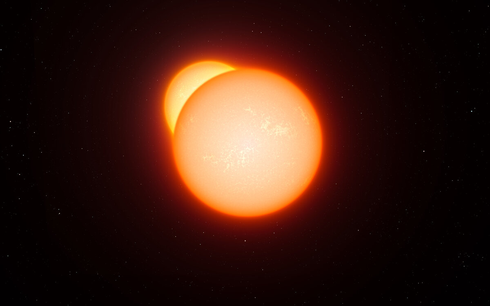
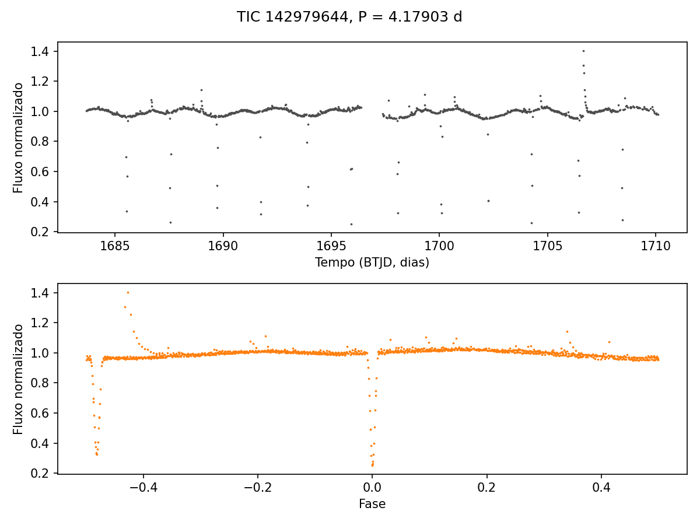
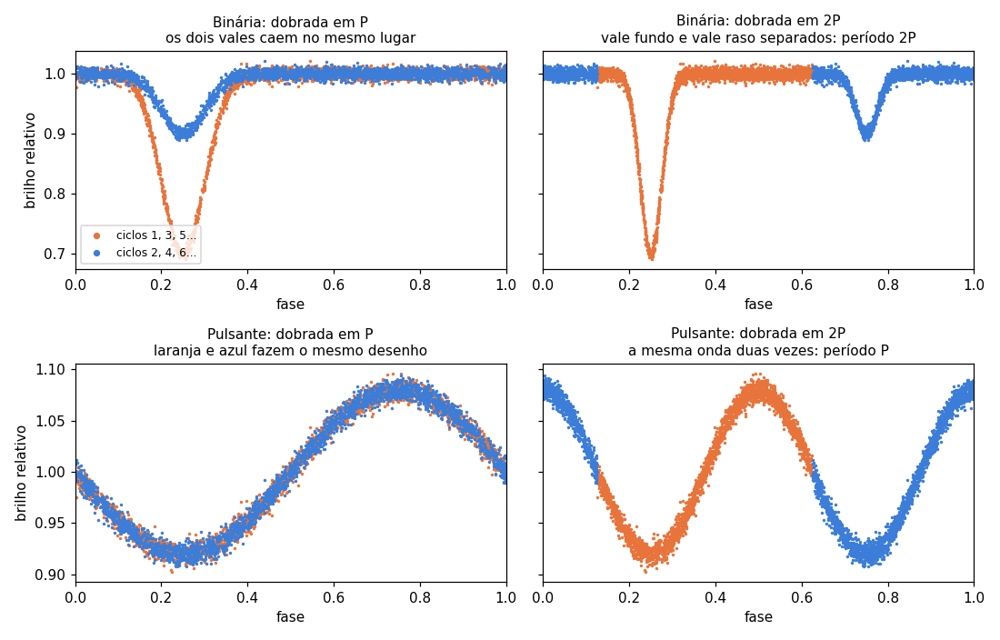
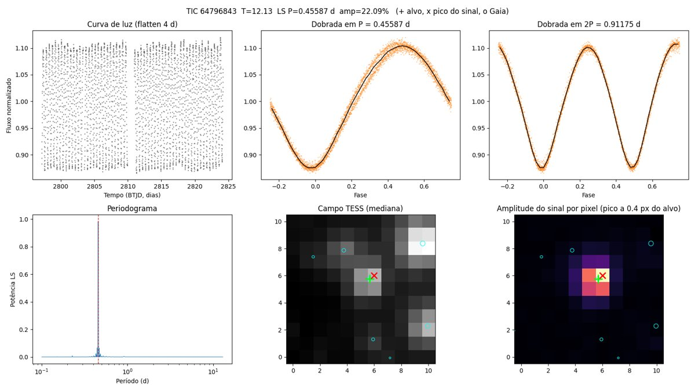
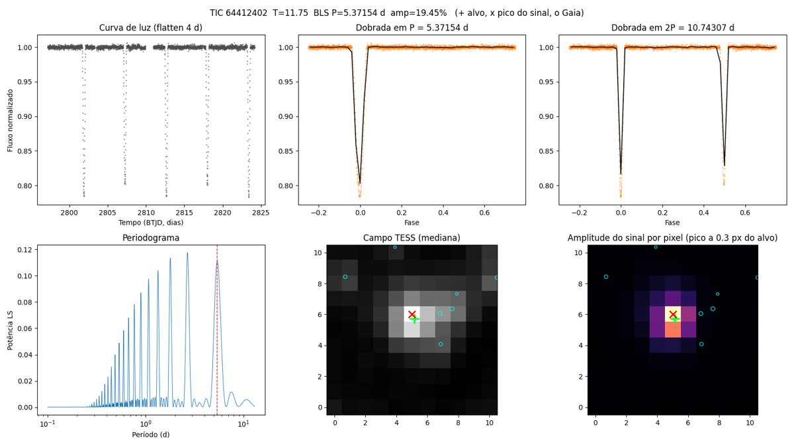
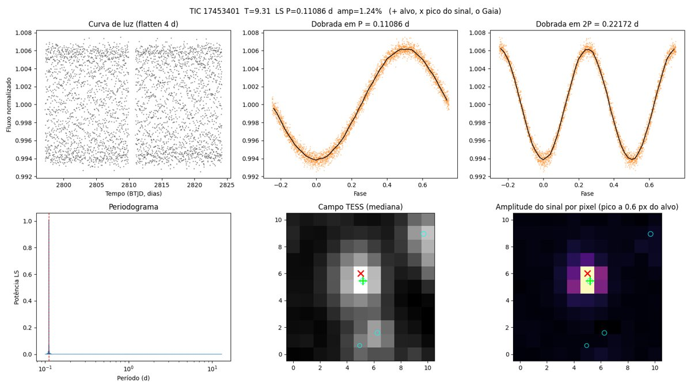
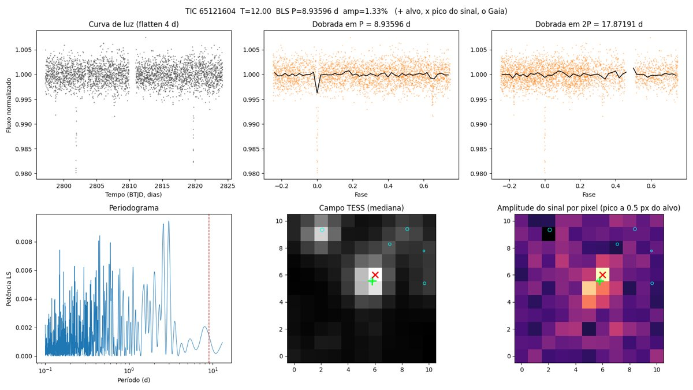
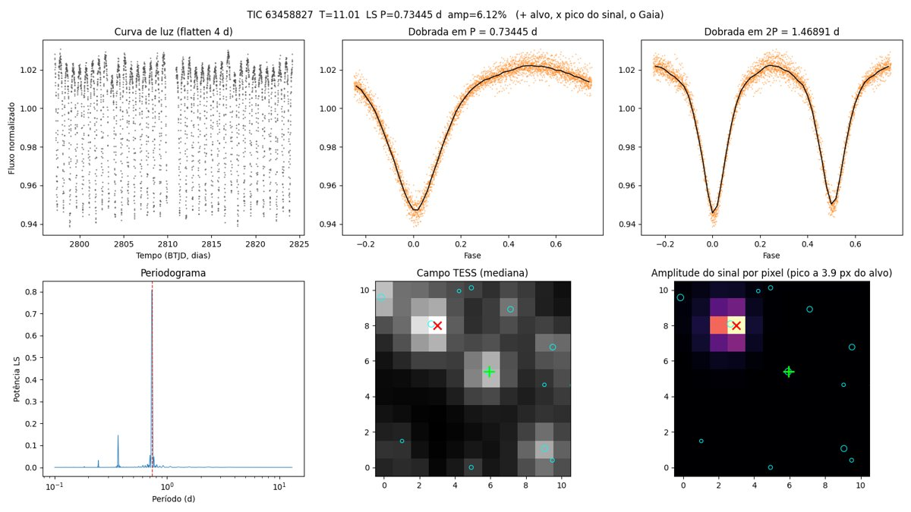
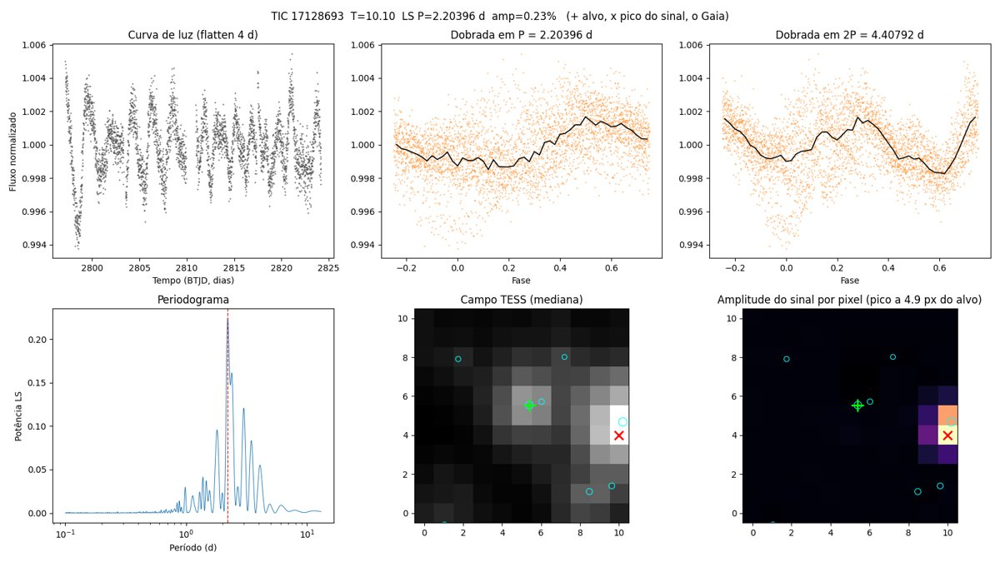

# Vagalume

[](https://github.com/mpena2099/vagalume/actions/workflows/testes.yml)

Pipeline pessoal de mineração de dados astronômicos que procura **estrelas variáveis ainda não catalogadas** nas curvas de luz públicas do satélite **TESS** (NASA), descarta as já conhecidas e entrega candidatas prontas para submissão ao **VSX**, o catálogo internacional de estrelas variáveis da AAVSO.



*Ilustração artística de uma binária eclipsante: duas estrelas em órbita passam uma na frente da outra, e o brilho somado cai a cada eclipse. Crédito: ESO/L. Calçada, [CC BY 4.0](https://creativecommons.org/licenses/by/4.0/).*

## English summary

Vagalume is a personal data-mining pipeline that searches public **TESS** light curves for **uncatalogued variable stars**, aiming at submissions to the AAVSO **VSX** catalogue. Seven sequential phases share state through SQLite: a sanity check that recovers known variables (WASP-18 b and two eclipsing binaries, periods within 0.1%), target selection from one TESS sector, light-curve download (QLP/TESS-SPOC via MAST), period search (Lomb-Scargle and BLS), cross-match against VSX, ATLAS, TESS-EBs, other TESS variability catalogues (including Wang+2025 from China-VO), Gaia DR2/DR3, ZTF, ASAS-SN, TOI and SIMBAD, a contamination check (variable neighbours, Gaia blends, persistence across other sectors) and one diagnostic figure per candidate, including a per-pixel signal map. A local Streamlit app supports human review. First run (sector 55, Cygnus, 500 stars): 39 periodic signals, 13 not found in any variable-star catalogue within 30", 9 candidates awaiting visual review. Code and docs are in Portuguese; `config.py` holds every parameter. Run with `python pipeline.py` (or `--proximo` to pick the next sky field automatically); offline tests with `python tests/test_units.py`.

## Em palavras simples

**A pergunta:** entre milhões de estrelas observadas pelo TESS, quais mudam de brilho e ainda não estão em nenhum catálogo?

**O que se procura:** estrelas que "piscam". Algumas são pares de estrelas que se eclipsam uma à outra (binárias eclipsantes). Outras pulsam, incham e encolhem. Outras giram com manchas na superfície. Em todos os casos o brilho sobe e desce num ritmo regular.

**Como achar:** o TESS mede o brilho de cada estrela a cada poucos minutos, durante semanas. Esse registro se chama *curva de luz*. O software procura nela um padrão que se repete, mede o período, verifica se o objeto já é conhecido e descarta sinais falsos, como a luz de uma estrela vizinha vazando para o mesmo pixel.



*Binária eclipsante TIC 142979644, período de 4,179 dias. Em cima, o brilho ao longo de um setor do TESS: as quedas são os eclipses. Embaixo, a mesma curva dobrada no período, com os dois eclipses (primário e secundário) sobrepostos. Gerada pela Fase 1 do pipeline. Dados: NASA/TESS via MAST, produto QLP.*

**A recompensa:** uma variável nova aceita no VSX entra no catálogo com o nome de quem a descobriu.

## Como funciona

Fases sequenciais que se comunicam por tabelas SQLite em `data/vagalume.db`. Cada fase tem uma função `run()`, lê a tabela da anterior e grava a sua. Toda a parametrização fica em `config.py`.

| Fase | Módulo | O que faz | Grava |
|---|---|---|---|
| 1 | `sanity_check` | Redescobre variáveis conhecidas e confere o período medido | (nada; aborta se falhar) |
| 2 | `selecionar_alvos` | Escolhe estrelas de um setor TESS por brilho e baixa contaminação | `alvos` |
| 3 | `baixar_curvas` | Baixa as curvas de luz QLP/TESS-SPOC do MAST, com cache | `curvas` |
| 4 | `detectar_sinal` | Busca periodicidade com Lomb-Scargle e BLS | `sinais` |
| 5 | `cruzar_conhecidos` | Cruza com VSX, ATLAS, TESS-EBs, outros catálogos de variáveis do TESS (inclusive Wang+2025, do China-VO), Gaia DR2/DR3, ZTF, ASAS-SN, TOI e SIMBAD | `sinais_fase5` |
| 6 | `checar_contaminacao` | Descarta sinais que podem vir de estrela vizinha | `candidatos` |
| 7 | `triagem` | Gera uma figura por candidata: curva, curva dobrada em P e 2P, periodograma, campo TESS e mapa do sinal por pixel | `candidatos_fase7` |
| revisão | `app/revisao.py` + `app/paginas/` | App local (Streamlit) para olhar cada candidata e marcar confirmar, dúvida ou descartar | `revisao_humana` |
| 8 | `ficha_vsx` | Para as confirmadas, monta a ficha do VSX: fonte Gaia DR3, V estimada, período medido com todos os setores do TESS (com o erro e um alerta quando os setores não concordam), tipo sugerido, época do mínimo em BJD, amplitude e curva em fase, e refaz a busca no VizieR inteiro | `data/vsx/` |

O envio ao VSX é manual (não há API): copie os campos da ficha para o formulário, seguindo o checklist da seção 11 da [especificação](especificacao.md). Tipo e período da ficha são sugestões; confira na curva em fase.

## Estado

As oito fases estão implementadas (a 8, ficha do VSX, roda à mão depois da revisão). A Fase 1 redescobre WASP-18 b, uma binária eclipsante destacada e uma de contato, com o período dentro de 0,1% da referência. A primeira varredura, no setor 55 (Cygnus, plano da Via Láctea), processou 500 estrelas: 39 com sinal periódico, 13 sem variável catalogada a menos de 30" e 9 candidatas depois da checagem de vizinhas e da repetição em outros setores. Elas aguardam a revisão visual. Detalhes técnicos, cortes, catálogos e riscos em [`especificacao.md`](especificacao.md).

## Uso

```bash
python3 -m venv venv && source venv/bin/activate
pip install -r requirements.txt
python -u pipeline.py           # campo fixo do config.py (fases 1 a 7 e casos do treino)
python -u pipeline.py --proximo # escolhe sozinho o próximo campo do céu e roda tudo
python tests/test_units.py      # testes offline (ou pytest)
streamlit run app/revisao.py    # revisão visual das candidatas
python src/ficha_vsx.py         # Fase 8: fichas do VSX das confirmadas (--duvidas, --todas)
```

`-u` faz o Python escrever cada `print` na hora. No terminal isso já acontece, mas com a saída redirecionada (`> log.txt`, `| tee log.txt`, `nohup`) o Python junta tudo em blocos e o log fica parado por minutos, parecendo travado, nas fases longas.

**Mais candidatas.** Terminou de revisar as candidatas da fila? O app mostra o botão "Buscar mais candidatas" (também na barra lateral), que pede confirmação antes de começar, e depois o progresso da busca, com um botão para cancelar; pelo terminal, o mesmo é `python -u pipeline.py --proximo`. A busca escolhe sozinho uma região do céu ainda não varrida, no plano da Via Láctea e coberta por um setor do TESS com cadência de 200 s, e roda tudo, inclusive os casos novos do treino (1 a 2 horas para 500 estrelas). As candidatas novas entram na fila do app junto com as antigas. As regiões já feitas ficam na tabela `campos_feitos`; uma rodada que falha no meio não conta e é refeita na próxima vez. A grade tem mais de mil regiões. Se um dia acabar, o comando avisa e não faz nada.

As decisões da revisão ficam na tabela `revisao_humana`, que o pipeline nunca recria. O app usa o tema escuro de `.streamlit/config.toml` e o visual de `app/estilo.py`; as páginas ficam em `app/paginas/`.

As curvas baixadas ficam em cache em `data/curvas/` e as figuras de triagem em `data/triagem/`.

## Revisão visual: como classificar

O app mostra, para cada candidata, os números principais, um checklist com seis itens e uma sugestão do pipeline, links para VSX e SIMBAD e uma figura com seis painéis:

| Painel | O que mostra | O que procurar |
|---|---|---|
| Curva de luz | O brilho ao longo do setor (~27 dias) | Variação que se repete o setor inteiro, sem saltos nas bordas das lacunas |
| Dobrada em P | Os ciclos sobrepostos no período medido; a linha preta é a mediana | Pontos caindo uns sobre os outros, com forma clara |
| Dobrada em 2P | O mesmo com o dobro do período | Se aparecem dois mínimos diferentes, o período real é 2P |
| Periodograma | A força de cada período candidato; a linha vermelha é o escolhido | Um pico alto e isolado |
| Campo TESS | Os pixels em volta (cada um tem 21"); + verde é o alvo, círculos são fontes Gaia | Estrelas vizinhas brilhantes dentro de 2 pixels |
| Sinal por pixel | Em que pixel a variação é mais forte; x vermelho é o pico | O x sobre o + (a menos de 1 pixel) |

**Como decidir**

| O que você vê | Decisão |
|---|---|
| Curva dobrada limpa, pico do sinal sobre o alvo, periodograma com um pico isolado | **Confirmar** |
| Pico do sinal em outro pixel, sobre outra estrela | **Descartar** (o sinal é da vizinha) |
| Curva dobrada borrada, sem forma, ou periodograma com vários picos do mesmo tamanho | **Descartar** |
| Período perto de 1 d, 13,7 d, 6,85 d ou 4,57 d, ou saltos nas bordas das lacunas | **Descartar** (sistemático do TESS) |
| VSX ou SIMBAD mostram uma variável já catalogada com esse período a até ~2' | **Descartar** (já conhecida) |
| Sinal real, mas com só 2 ou 3 eventos no setor, ou com alerta de vizinha brilhante | **Dúvida** |

**P ou 2P, e o tipo.** Dobrar em P é cortar a curva em pedaços de P dias e empilhar; em 2P, os pedaços têm o dobro do tamanho e levam dois ciclos de P lado a lado. Numa binária a estrela escurece duas vezes por volta, e o programa costuma achar metade do período verdadeiro. Na figura (curvas simuladas, ciclos de P alternados em laranja e azul), o eclipse fundo e o raso da binária caem um por cima do outro em P e se separam em 2P: período 2P. Na pulsante, laranja e azul fazem o mesmo desenho, e 2P só repete a onda: período P.



Para a ficha do VSX importam o período certo e o tipo:
- **EA** (binária destacada): eclipses estreitos e brilho plano entre eles. Quando o segundo eclipse é raso demais para aparecer, o período medido costuma ser a metade do real: em P, metade dos pontos atravessa o vale em 1,00 (metade dos ciclos sem eclipse), e em 2P sobra um vale só por ciclo. O período real é 2P.
- **EB**: brilho variando o tempo todo e mínimos de profundidades diferentes. O período real é o que mostra os dois mínimos (em geral 2P).
- **EW** (binária de contato): variação contínua e mínimos quase iguais. Aqui está a armadilha: em 2P os dois mínimos são iguais e parece que P basta, mas o período real é 2P. Amplitude grande (acima de ~10%) e 2P (o período orbital) acima de ~0,22 d favorecem EW.
- **Pulsante ou rotação**: um ciclo limpo por período; em 2P aparecem dois ciclos idênticos. Se 2P fica abaixo de ~0,22 d, só pode ser pulsante (nenhuma binária de contato tem órbita tão curta); perto desse limite, quem decide é a amplitude. Rotação (manchas) costuma mudar de forma de um setor para outro.

A Fase 8 mede o período juntando todos os setores do TESS da estrela: um setor só (27 dias) pode enganar numa binária de período longo, que mostra um eclipse fundo e um raso e parece ter metade do período. Ela também sugere o tipo, mas a palavra final é sua. **Confirmar** não é descoberta: quer dizer que passa no olho. **Descartar** não apaga nada: a decisão fica gravada com a nota e dá para rever no filtro "Situação".

**Checklist e sugestão do pipeline.** Acima da figura, cada candidata mostra seis itens com ícone: ✅ quando está tudo bem, ⚠️ quando pede atenção e ❌ quando pesa contra. Os itens são o pico do sinal no alvo (até 1 px), a repetição em outros setores, o número de ciclos (4 ou mais), a força do sinal (5 vezes o ruído ou mais), a vizinha brilhante e a presença no Gaia DR3. O app resume tudo em uma sugestão (Confirmado, Dúvida ou Descartado), que vale só se a curva dobrada em P tiver uma linha clara. A curva em 2P fica num expansor à parte: não decide se é real, só escolhe o período da ficha do VSX. A decisão continua sendo sua.

**Modo treino.** A página Treino (na barra lateral) mostra casos com resposta conhecida: variáveis já catalogadas e sinais que o pipeline descartou (vizinha variável, sinal que não se repete, período de sistemático do TESS, sinal fraco demais, poucos ciclos), em número parecido. Ela exibe a curva em P e o mapa, os números e o checklist, sem a resposta; nos casos com período conferido no VSX, depois da decisão vem a curva em 2P e a pergunta "P ou 2P?". Você escolhe Confirmar, Dúvida ou Descartar, vê a resposta certa com a explicação e acumula pontos (dúvida vale meio ponto). Cada resposta fica gravada no banco, e o quadro "Seu histórico" mostra o acerto geral, o das últimas 20 respostas e o acerto separado por resposta certa: diferença grande entre eles indica viés, como confirmar quase tudo. No topo do treino aparece o nível (Aprendiz, Revisor ou Revisor confiável, pelas últimas 20 respostas), e a revisão mostra a trilha até o VSX: treino em dia, fila revisada, ficha pronta, enviada e aceita (as duas últimas você marca). Nada dá ponto por confirmar candidata. Gere os casos com `python -u tools/gerar_treino.py`; o script usa a rede e retoma de onde parou.

**Casos de referência.** Todos são variáveis já catalogadas ou sinais que o próprio pipeline descartou (gerados por `python -u tools/gerar_referencias.py`).

*Confirmar: binária de contato, período real 2P*



TIC 64796843 (NSVS 5748012, no VSX com P = 0,9117 d). O LS mede 0,4559 d, metade do período real. Em P a curva parece uma senoide; em 2P aparecem dois mínimos quase iguais. A amplitude de 22% é grande demais para manchas ou pulsação comum nesse período: é binária de contato, período 2P. Pico do sinal a 0,4 px do alvo.

*Confirmar: binária destacada (EA)*



TIC 64412402 (no VSX com P = 5,3754 d). Cinco eclipses de ~20% no setor, brilho plano entre eles. Em 2P os dois eclipses têm quase a mesma profundidade, então o VSX adota P; se as profundidades fossem diferentes, o período seria 2P. O periodograma mostra uma escada de harmônicos, típica de eclipse estreito: é por isso que o pipeline usa o BLS nesses casos.

*Confirmar: pulsante*



TIC 17453401 (no VSX com P = 0,11086 d). Senoide limpa de 1,2%, periodograma com um único pico. Em 2P aparecem dois ciclos idênticos, e com 0,11 d nenhuma binária de contato cabe: é pulsante (provável delta Scuti), período P.

*Dúvida: poucos eventos*



TIC 65121604. Só dois eclipses de ~2% no setor, a 18 dias um do outro. O BLS escolheu 8,94 d, mas com dois eventos o período pode ser 17,9 d ou outra fração. O periodograma não ajuda (ruído). O sinal parece real e está no alvo, mas o período não está fechado: **dúvida** até haver outro setor.

*Descartar: o sinal é de uma vizinha*



TIC 63458827. A curva dobrada é bonita (binária com mínimos iguais em 2P), mas o painel do sinal por pixel mostra o pico a 3,9 px do alvo, sobre outra estrela. A Fase 6 achou essa vizinha catalogada como variável com o mesmo período a 86". O alvo só recebe a luz dela.

*Descartar: não se repete e vem de outra estrela*



TIC 17128693. Amplitude de 0,23%, curva dobrada borrada, periodograma com vários picos parecidos. Nos outros setores o período mudou (2,49 e 2,24 d), e o pico do sinal está a 4,9 px do alvo, numa estrela brilhante do canto do recorte. Dois motivos para descartar.

## Dados e créditos

- Curvas de luz: missão TESS (NASA), via [MAST](https://archive.stsci.edu/), produtos [QLP](https://archive.stsci.edu/hlsp/qlp) e [TESS-SPOC](https://archive.stsci.edu/hlsp/tess-spoc).
- Catálogos de variáveis: [VSX/AAVSO](https://vsx.aavso.org), [TESS-EBs](https://archive.stsci.edu/hlsp/tess-ebs), Gaia DR3, ZTF, ASAS-SN, via [VizieR](https://vizier.cds.unistra.fr/); tipos de objeto do [SIMBAD](https://simbad.cds.unistra.fr/); TOIs do [ExoFOP](https://exofop.ipac.caltech.edu/tess/); catálogo de variáveis do TESS de Wang et al. (2025), via China-VO.
- Este projeto usou o banco de dados SIMBAD e o serviço VizieR, operados no CDS, Estrasburgo, França.
- Projeto irmão: Rastro, caça a anãs marrons por movimento próprio no CatWISE2020.

## Licença

Código sob a licença [MIT](LICENSE). Imagens de terceiros mantêm a licença indicada na legenda.
