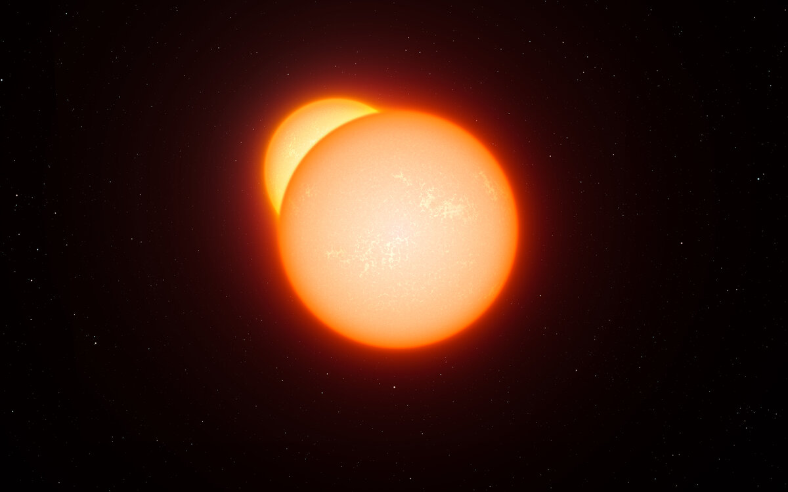

# Vagalume

Pipeline de mineração de dados astronômicos que procura **estrelas variáveis ainda não catalogadas** nas curvas de luz públicas do satélite **TESS** (NASA), descarta as já conhecidas e entrega candidatas prontas para submissão ao **VSX**, o catálogo internacional de estrelas variáveis da AAVSO.

*Ilustração artística de uma binária eclipsante: duas estrelas em órbita passam uma na frente da outra, e o brilho somado cai a cada eclipse. Crédito: ESO/L. Calçada, [CC BY 4.0](https://creativecommons.org/licenses/by/4.0/).*

## Em palavras simples

**A pergunta:** entre milhões de estrelas observadas pelo TESS, quais mudam de brilho e ainda não estão em nenhum catálogo?

**O que se procura:** estrelas que "piscam". Algumas são pares de estrelas que se eclipsam uma à outra (binárias eclipsantes). Outras pulsam, incham e encolhem. Outras giram com manchas na superfície. Em todos os casos o brilho sobe e desce num ritmo regular.

**Como achar:** o TESS mede o brilho de cada estrela a cada poucos minutos, durante semanas. Esse registro se chama *curva de luz*. O software procura nela um padrão que se repete, mede o período, verifica se o objeto já é conhecido e descarta sinais falsos, como a luz de uma estrela vizinha vazando para o mesmo pixel.

*Binária eclipsante TIC 142979644, período de 4,179 dias. Em cima, o brilho ao longo de um setor do TESS: as quedas são os eclipses. Embaixo, a mesma curva dobrada no período, com os dois eclipses (primário e secundário) sobrepostos. Gerada pela Fase 1 do pipeline. Dados: NASA/TESS via MAST, produto QLP.*

**A recompensa:** uma variável nova aceita no VSX entra no catálogo com o nome de quem a descobriu.

## Resultados

O que a varredura do autor já encontrou, com o que deu certo e o que não deu, está em [Resultados](resultados.md).
