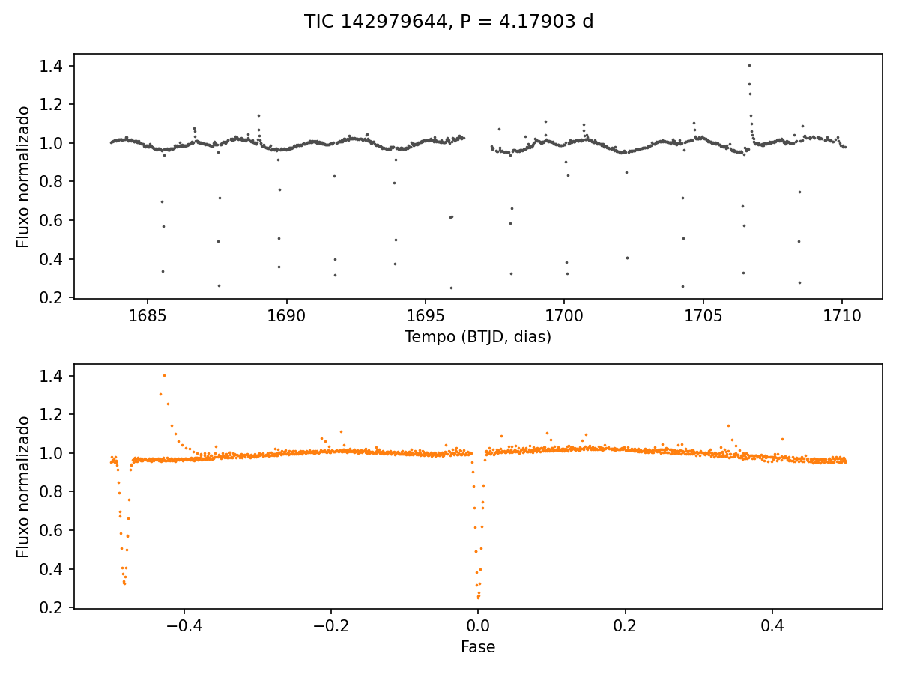

# Vagalume

Pipeline pessoal de mineração de dados astronômicos que procura **estrelas variáveis ainda não catalogadas** nas curvas de luz públicas do satélite **TESS** (NASA), descarta as já conhecidas e entrega candidatas prontas para submissão ao **VSX**, o catálogo internacional de estrelas variáveis da AAVSO.

> **Situação:** a primeira candidata foi submetida ao VSX em novembro de 2026 e aguarda a moderação, que costuma levar semanas. As outras 3 confirmadas na revisão do primeiro campo (Cygnus, setor 55) esperam esse aceite, porque o VSX só aceita uma submissão de cada usuário novo até a primeira ser aprovada. Antes do envio, o pipeline confere sozinho o período entre setores, os eclipses pares e ímpares, a vizinha suspeita de blend e o VSX ao vivo; mesmo assim, trate cada resultado como candidata até o aceite.

*Ilustração artística de uma binária eclipsante: duas estrelas em órbita passam uma na frente da outra, e o brilho somado cai a cada eclipse. Crédito: ESO/L. Calçada, [CC BY 4.0](https://creativecommons.org/licenses/by/4.0/).*

## Em palavras simples

**A pergunta:** entre milhões de estrelas observadas pelo TESS, quais mudam de brilho e ainda não estão em nenhum catálogo?

**O que se procura:** estrelas que "piscam". Algumas são pares de estrelas que se eclipsam uma à outra (binárias eclipsantes). Outras pulsam, incham e encolhem. Outras giram com manchas na superfície. Em todos os casos o brilho sobe e desce num ritmo regular.

**Como achar:** o TESS mede o brilho de cada estrela a cada poucos minutos, durante semanas. Esse registro se chama *curva de luz*. O software procura nela um padrão que se repete, mede o período, verifica se o objeto já é conhecido e descarta sinais falsos, como a luz de uma estrela vizinha vazando para o mesmo pixel.

*Binária eclipsante TIC 142979644, período de 4,179 dias. Em cima, o brilho ao longo de um setor do TESS: as quedas são os eclipses. Embaixo, a mesma curva dobrada no período, com os dois eclipses (primário e secundário) sobrepostos. Gerada pela Fase 1 do pipeline. Dados: NASA/TESS via MAST, produto QLP.*

**A recompensa:** uma variável nova aceita no VSX entra no catálogo com o nome de quem a descobriu.

## Estado

As oito fases estão implementadas (a 8, ficha do VSX, roda à mão depois da revisão). A Fase 1 redescobre WASP-18 b, uma binária eclipsante destacada e uma de contato, com o período dentro de 0,1% da referência. A primeira varredura, no setor 55 (Cygnus, plano da Via Láctea), processou 566 estrelas: 51 com sinal periódico, 19 sem variável catalogada a menos de 30" e 14 candidatas depois da checagem de vizinhas e da repetição em outros setores. Na revisão visual, 4 foram confirmadas, 3 ficaram em dúvida e 7 foram descartadas. Detalhes técnicos, cortes, catálogos e riscos em [`especificacao.md`](https://github.com/mpena2099/vagalume/blob/main/especificacao.md).

## Achados

O que o projeto encontrou até agora, inclusive o que não deu certo:

| Achado | Estágio | O que ensinou |
|---|---|---|
| Teste de sanidade: WASP-18 b, uma binária eclipsante destacada e uma de contato são redescobertas com o período a menos de 0,1% da referência | Feito a cada execução | A detecção de período funciona nos três tipos de sinal |
| Setor 55 (Cygnus): 566 estrelas, 51 com sinal periódico, 19 sem variável catalogada a menos de 30", 14 candidatas | Revisadas: 4 confirmadas, 3 em dúvida e 7 descartadas; a primeira submetida ao VSX, as outras 3 esperando o aceite dela | A checagem de estrelas vizinhas e a repetição em outros setores cortam a maior parte |
| Uma candidata, a TIC 64711184, já estava publicada como pulsante SPB (catálogo J/ApJS/268/16), fora das listas que o pipeline cruzava | Saiu da fila: o catálogo entrou no cruzamento | Daí veio a busca no VizieR inteiro antes da ficha do VSX, e os catálogos achados assim passaram a ser cruzados |
