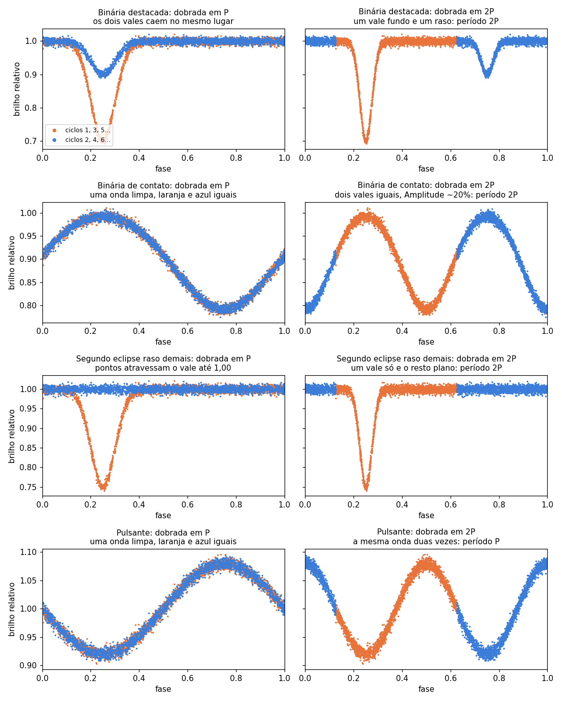
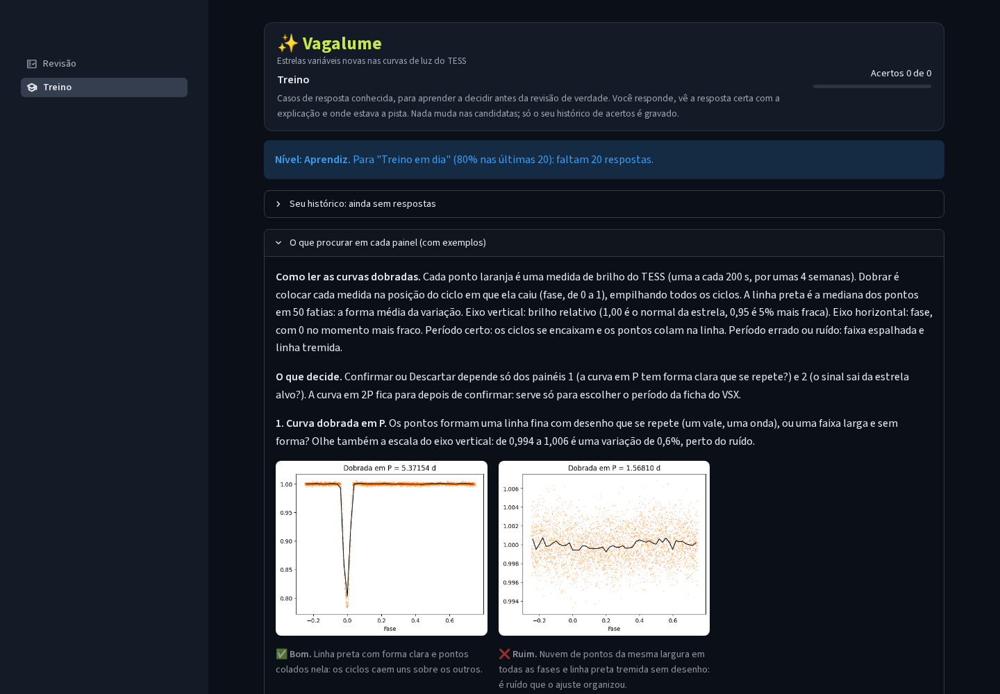
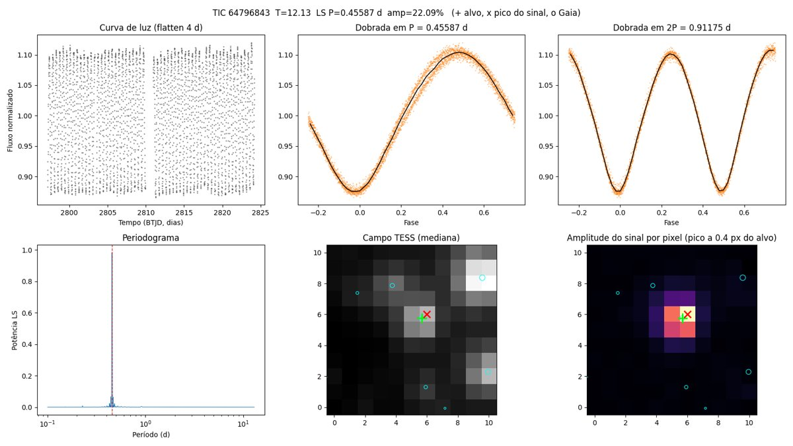
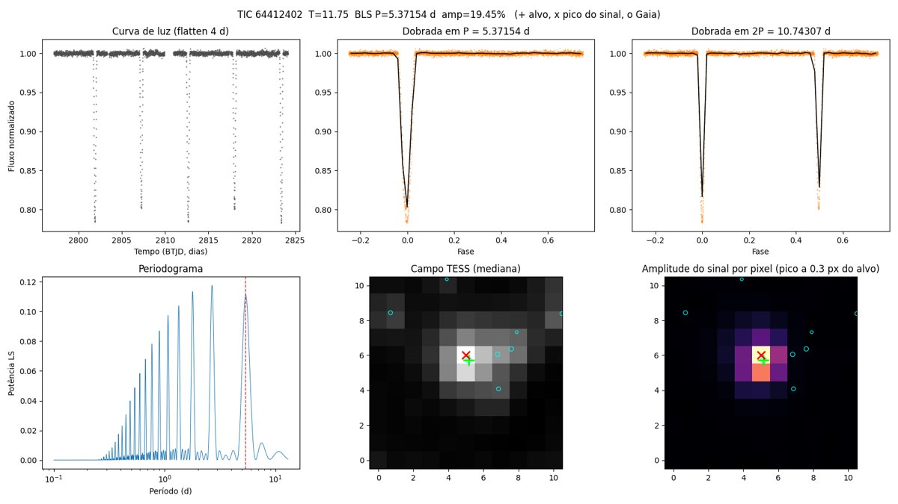
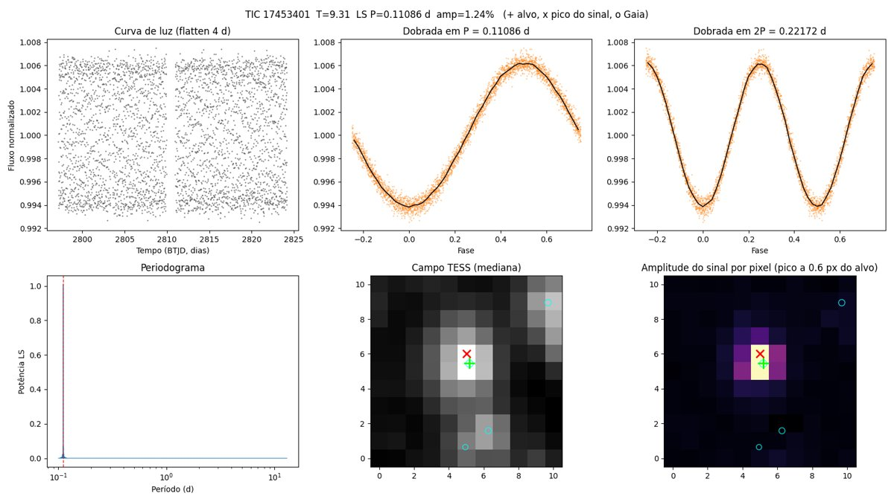
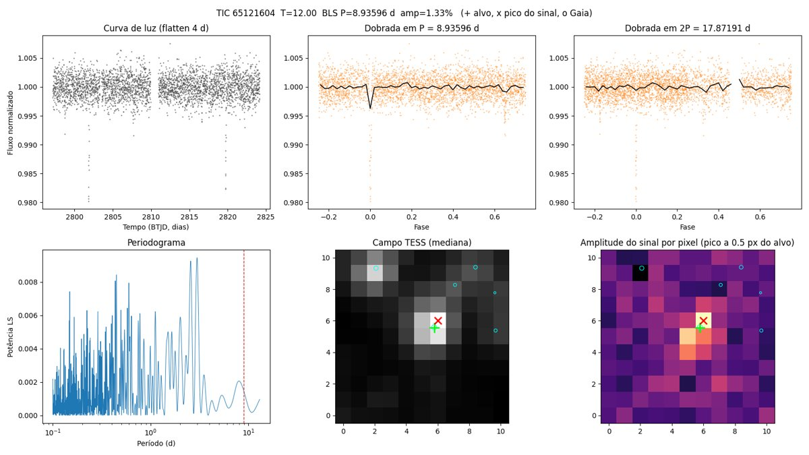
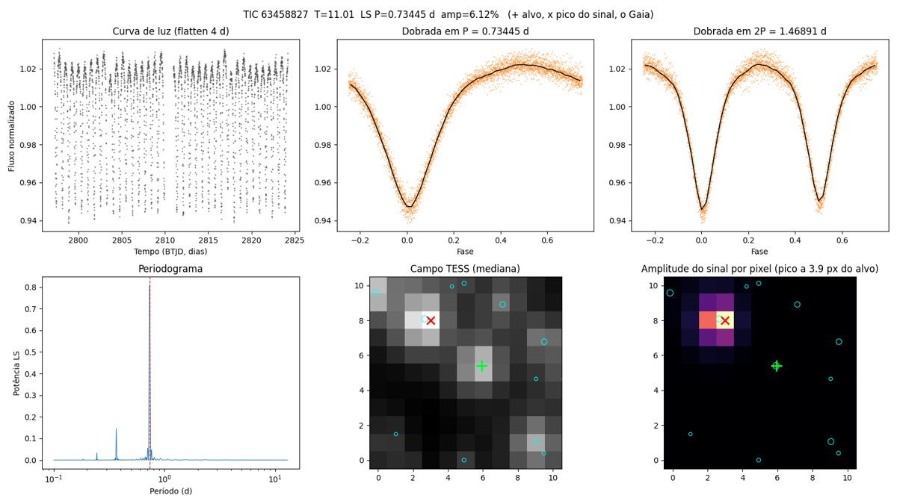
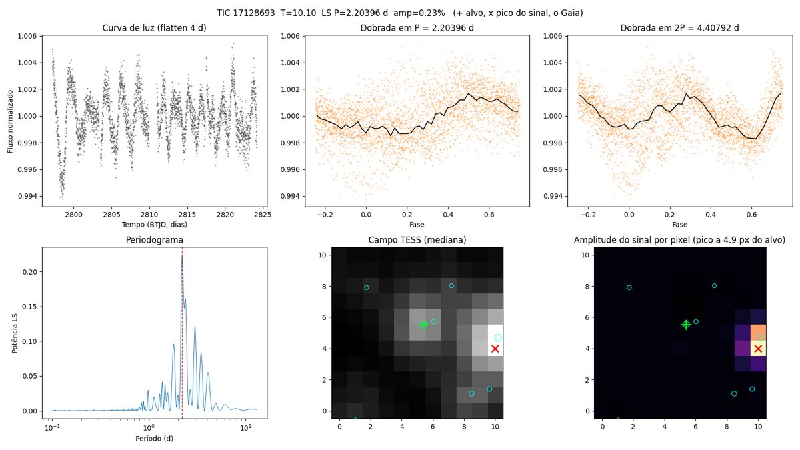

# Revisão e treino

## Revisão visual: como classificar

O app mostra, para cada candidata, os números principais, um checklist com seis itens e uma sugestão do pipeline, links para VSX e SIMBAD e uma figura com seis painéis:

| Painel | O que mostra | O que procurar |
|---|---|---|
| Curva de luz | O brilho ao longo do setor (~27 dias) | Variação que se repete o setor inteiro, sem saltos nas bordas das lacunas |
| Dobrada em P | Os ciclos sobrepostos no período medido; a linha preta é a mediana | Pontos caindo uns sobre os outros, com forma clara |
| Dobrada em 2P | O mesmo com o dobro do período | Se aparecem dois mínimos diferentes, o período real é 2P |
| Periodograma | A força de cada período candidato; a linha vermelha é o escolhido | Um pico alto e isolado |
| Campo TESS | Os pixels em volta (cada um tem 21"); + verde é o alvo, círculos são fontes Gaia | Estrelas vizinhas brilhantes dentro de 2 pixels |
| Sinal por pixel | Em que pixel a variação é mais forte; x vermelho é o pico | O x sobre o + (a menos de 1 pixel) |

**Como decidir**

| O que você vê | Decisão |
|---|---|
| Curva dobrada limpa, pico do sinal sobre o alvo, periodograma com um pico isolado | **Confirmar** |
| Pico do sinal em outro pixel, sobre outra estrela | **Descartar** (o sinal é da vizinha) |
| Curva dobrada borrada, sem forma, ou periodograma com vários picos do mesmo tamanho | **Descartar** |
| Alerta "Período perto de um ritmo do satélite" com o pico do sinal fora do alvo, ou saltos nas bordas das lacunas | **Descartar** (sistemático do TESS) |
| VSX ou SIMBAD mostram uma variável já catalogada com esse período a até ~2' | **Descartar** (já conhecida) |
| Sinal real, mas com só 2 ou 3 eventos no setor, ou com alerta de vizinha brilhante | **Dúvida** |

**P ou 2P, e o tipo.** Dobrar em P é cortar a curva em pedaços de P dias e empilhar; em 2P, os pedaços têm o dobro do tamanho e levam dois ciclos de P lado a lado. Numa binária a estrela escurece duas vezes por volta, e o programa costuma achar metade do período verdadeiro. Na figura (curvas simuladas, ciclos de P alternados em laranja e azul), o eclipse fundo e o raso da binária caem um por cima do outro em P e se separam em 2P: período 2P. Na pulsante, laranja e azul fazem o mesmo desenho, e 2P só repete a onda: período P.

Para a ficha do VSX importam o período certo e o tipo:
- **EA** (binária destacada): eclipses estreitos e brilho plano entre eles. Quando o segundo eclipse é raso demais para aparecer, o período medido costuma ser a metade do real: em P, metade dos pontos atravessa o vale em 1,00 (metade dos ciclos sem eclipse), e em 2P sobra um vale só por ciclo. O período real é 2P.
- **EB**: brilho variando o tempo todo e mínimos de profundidades diferentes. O período real é o que mostra os dois mínimos (em geral 2P).
- **EW** (binária de contato): variação contínua e mínimos quase iguais. Aqui está a armadilha: em 2P os dois mínimos são iguais e parece que P basta, mas o período real é 2P. Amplitude grande (acima de ~10%) e 2P (o período orbital) acima de ~0,22 d favorecem EW.
- **Pulsante ou rotação**: um ciclo limpo por período; em 2P aparecem dois ciclos idênticos. Se 2P fica abaixo de ~0,22 d, só pode ser pulsante (nenhuma binária de contato tem órbita tão curta); perto desse limite, quem decide é a amplitude. Rotação (manchas) costuma mudar de forma de um setor para outro.

A Fase 8 mede o período juntando todos os setores do TESS da estrela: um setor só (27 dias) pode enganar numa binária de período longo, que mostra um eclipse fundo e um raso e parece ter metade do período. Ela também sugere o tipo, mas a palavra final é sua. **Confirmar** não é descoberta: quer dizer que passa no olho. **Descartar** não apaga nada: a decisão fica gravada com a nota e dá para rever no filtro "Situação".

**Checklist e sugestão do pipeline.** Acima da figura, cada candidata mostra seis itens com ícone: ✅ quando está tudo bem, ⚠️ quando pede atenção e ❌ quando pesa contra. Os itens são o pico do sinal no alvo (até 1 px), a repetição em outros setores, o número de ciclos (4 ou mais), a força do sinal (5 vezes o ruído ou mais), a vizinha brilhante e a presença no Gaia DR3. O app resume tudo em uma sugestão (Confirmado, Dúvida ou Descartado), que vale só se a curva dobrada em P tiver uma linha clara. A curva em 2P fica num expansor à parte: não decide se é real, só escolhe o período da ficha do VSX. A decisão continua sendo sua.

**Modo treino.** A página Treino (na barra lateral) mostra casos com resposta conhecida: variáveis já catalogadas e sinais que o pipeline descartou (vizinha variável, sinal que não se repete, sinal fraco demais), em número parecido. Ela exibe a curva em P e o mapa, os números e o checklist, sem a resposta; nos casos com período conferido no VSX, depois da decisão vem a curva em 2P e a pergunta "P ou 2P?". Você escolhe Confirmar, Dúvida ou Descartar, vê a resposta certa com a explicação e acumula pontos (dúvida vale meio ponto). Cada resposta fica gravada no banco, e o quadro "Seu histórico" mostra o acerto geral, o das últimas 20 respostas e o acerto separado por resposta certa: diferença grande entre eles indica viés, como confirmar quase tudo. No topo do treino aparece o nível (Aprendiz, Revisor ou Revisor confiável, pelas últimas 20 respostas), e a revisão mostra a trilha até o VSX: fila revisada, ficha pronta, enviada e aceita, com o treino como etapa opcional. Nada dá ponto por confirmar candidata. Gere os casos com `python -u tools/gerar_treino.py`; o script usa a rede e retoma de onde parou.

**[Experimente o treino online](https://vagalume.streamlit.app/?embed=true)**: casos de resposta conhecida, direto no navegador, sem instalar nada. As suas respostas ficam só na sua sessão.

*O modo treino, com casos de resposta conhecida: o guia mostra o que procurar em cada painel, com um exemplo bom e um ruim tirados de variáveis já catalogadas.*

**Casos de referência.** Todos são variáveis já catalogadas ou sinais que o próprio pipeline descartou (gerados por `python -u tools/gerar_referencias.py`).

*Confirmar: binária de contato, período real 2P*

TIC 64796843 (NSVS 5748012, no VSX com P = 0,9117 d). O LS mede 0,4559 d, metade do período real. Em P a curva parece uma senoide; em 2P aparecem dois mínimos quase iguais. A amplitude de 22% é grande demais para manchas ou pulsação comum nesse período: é binária de contato, período 2P. Pico do sinal a 0,4 px do alvo.

*Confirmar: binária destacada (EA)*

TIC 64412402 (no VSX com P = 5,3754 d). Cinco eclipses de ~20% no setor, brilho plano entre eles. Em 2P os dois eclipses têm quase a mesma profundidade, então o VSX adota P; se as profundidades fossem diferentes, o período seria 2P. O periodograma mostra uma escada de harmônicos, típica de eclipse estreito: é por isso que o pipeline usa o BLS nesses casos.

*Confirmar: pulsante*

TIC 17453401 (no VSX com P = 0,11086 d). Senoide limpa de 1,2%, periodograma com um único pico. Em 2P aparecem dois ciclos idênticos, e com 0,11 d nenhuma binária de contato cabe: é pulsante (provável delta Scuti), período P.

*Dúvida: poucos eventos*

TIC 65121604. Só dois eclipses de ~2% no setor, a 18 dias um do outro. O BLS escolheu 8,94 d, mas com dois eventos o período pode ser 17,9 d ou outra fração. O periodograma não ajuda (ruído). O sinal parece real e está no alvo, mas o período não está fechado: **dúvida** até haver outro setor.

*Descartar: o sinal é de uma vizinha*

TIC 63458827. A curva dobrada é bonita (binária com mínimos iguais em 2P), mas o painel do sinal por pixel mostra o pico a 3,9 px do alvo, sobre outra estrela. A Fase 6 achou essa vizinha catalogada como variável com o mesmo período a 86". O alvo só recebe a luz dela.

*Descartar: não se repete e vem de outra estrela*

TIC 17128693. Amplitude de 0,23%, curva dobrada borrada, periodograma com vários picos parecidos. Nos outros setores o período mudou (2,49 e 2,24 d), e o pico do sinal está a 4,9 px do alvo, numa estrela brilhante do canto do recorte. Dois motivos para descartar.
